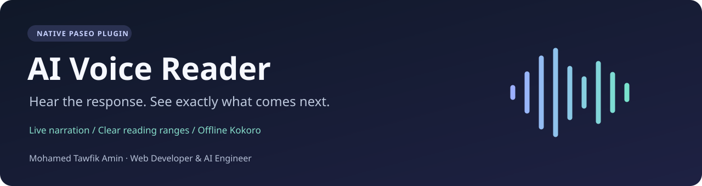
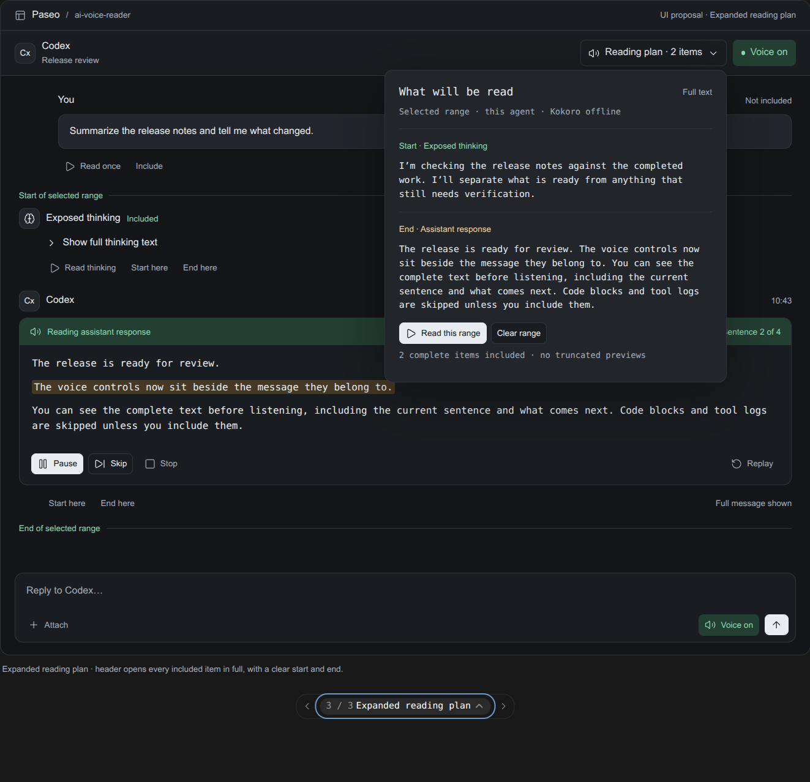

<div align="center">



**Native voice playback for your AI workspace.**

Live narration · Full reading previews · Offline speech · Controls beside your messages


[](LICENSE)

Built by **[Mohamed Tawfik Amin](#about-the-creator)** · Web Developer & AI Engineer

[Get started](#get-started) · [How it works](#engineering) · [Validation](docs/VALIDATION.md) · [Contact](mailto:m.t.amin1983@gmail.com)

</div>

## Give your agent a voice

AI Voice Reader adds automatic text-to-speech to the existing [Paseo](https://paseo.sh) interface. Hear newly completed sentences as an agent responds, inspect exactly what will be spoken, or select a start and end message to listen to a conversation range.

It is a native plugin built with the official `@getpaseo/plugin` SDK. Playback uses `client.playAudio()` on the connected Paseo client. Installation does not require modifying Paseo core or your agent profiles.

| Capability | What you get |
| --- | --- |
| Live narration | Newly completed sentences, with streamed-content deduplication |
| A visible reading plan | Full spoken text, exact queued sentences and clear range boundaries |
| Inline controls | Read, preview, include/exclude and select ranges beside text messages |
| Exposed thinking | Optional narration of provider-published `reasoning` items |
| Playback control | Play, Pause, Resume, Stop, Skip and Replay |
| Voice options | Edge Neural cloud voices or local Kokoro CPU speech |
| Privacy controls | Explicit cloud consent and filters for code, JSON, logs and possible secrets |
| Multi-agent support | Current-target or all-agent scope with one serial queue per client |

**Hidden model reasoning is never accessed.** Sent messages and exposed thinking are excluded by default and require their content filters to be enabled.

<details>
<summary><strong>Preview the selected reading-plan design</strong></summary>



*Design preview using public sample text. This is the selected UI concept, not a capture of the installed plugin. Native theme, text rendering and spacing can differ.*

</details>

## Get started

The tested environment is **Ubuntu**, **Paseo 0.11.4**, **Node.js 22**, and **Python 3.14**. The manifest accepts Paseo `>=0.11.4 <0.12.0`. Other operating systems and later Paseo versions have not been validated.

### 1. Prepare the source and speech dependencies

Clone the project and prepare its local dependencies:

```bash
git clone https://github.com/moamin1983/paseo-ai-voice-reader.git
cd paseo-ai-voice-reader
npm ci
./scripts/setup-tts.sh
```

The setup script creates a local `.venv`, installs the pinned Python dependency tree with SHA-256 verification, and prints the Python and worker paths to enter in Voice settings. It downloads packages from PyPI when run. Plugin activation itself does not download packages or models.

### 2. Install into Paseo

Enable trusted plugins in Paseo if you have not already chosen to do so, then run:

```bash
paseo plugin install "$PWD"
paseo plugin ls ai-voice-reader
```

Plugins run as trusted code on the daemon and connected client. Review the source before installing. For a remote daemon, prepare the Python environment and model paths on that daemon's machine. Use Paseo's `--host` option to target it explicitly.

### 3. Configure and listen

1. Open **Settings → Plugins → AI Voice Reader**.
2. Under **Python and local model paths**, enter the absolute Python and worker paths printed by the setup script. Save them.
3. Choose **Kokoro** with local model files, or **Edge Neural** and accept its cloud privacy consent. Choose a voice and speed, then enable the master switch.
4. Use **Check** to inspect backend readiness, then **Test voice** to hear public sample sentences.
5. Press **Voice Off** beside an agent composer to turn automatic narration on. Open **Reading plan** in the header to inspect the full text and queue.

To listen to history, mark **Start reading here** and **Stop reading here** beside completed messages, then press **Play** in the reading plan. Both endpoints are included. `/voice` also opens the reader panel.

### Offline Kokoro

Kokoro uses local `sherpa-onnx` CPU inference. The tested English v0.19 model directory contains:

```text
model.onnx
voices.bin
tokens.txt
espeak-ng-data/
```

Obtain a compatible model separately from the [sherpa-onnx Kokoro documentation](https://k2-fsa.github.io/sherpa/onnx/tts/pretrained_models/kokoro.html), review its license, and set its absolute directory in Voice settings. Weights are not included in this repository. The 11 speaker choices match the tested English model; other model layouts are not claimed compatible. After dependencies and model files are prepared, Kokoro inference requires no network access.

### Edge Neural and privacy

Edge sends readable narration text to Microsoft's TTS service. General cloud narration, exposed reasoning, and code or sensitive text have separate consent controls. Filters are best-effort; use offline Kokoro for confidential material. There is no automatic fallback from offline speech to cloud speech. Tool-call timeline rows are always excluded.

See [privacy and data flow](docs/PRIVACY.md) for the complete behavior.

## Engineering

This project connects native interface work with the reliability problems of streamed AI output:

- **Stream reconciliation:** handles canonical chunks and merged projected rows, tracks source offsets, and queues each newly completed span once. A native daemon returning projected rows despite canonical requests is covered by regression tests.
- **Lifecycle handling:** timeline subscriptions and official `agent.turn_ended` hooks cover reconnects, completion, partial tails, cancellation and replacement. Initial load and reload do not automatically replay history.
- **Playback coordination:** one serial queue per client prevents simultaneous agent speech. Generation tracking rejects stale synthesis after Stop, cancellation or reload.
- **Native UI:** supported React Native plugin components use the active theme. Inline source matches fail closed when ambiguous; exact ranges remain selectable in the reading plan.
- **Settings and policy:** Zod contracts, official persisted settings, revision-aware updates, and server-side privacy checks keep UI and synthesis behavior aligned.

| Area | Source |
| --- | --- |
| Native surfaces and registration | [`index.client.tsx`](index.client.tsx), [`client/`](client/) |
| Queue, agent scope and subscriptions | [`client/queue.ts`](client/queue.ts), [`client/runtime.ts`](client/runtime.ts) |
| Timeline reconciliation and filtering | [`shared/timeline.ts`](shared/timeline.ts), [`shared/text.ts`](shared/text.ts) |
| Settings and validated RPCs | [`shared/settings.ts`](shared/settings.ts), [`shared/contracts.ts`](shared/contracts.ts) |
| Lifecycle hooks and synthesis policy | [`index.server.ts`](index.server.ts) |
| Edge and offline speech | [`server/`](server/) |
| Automated verification | [`tests/`](tests/) |

Compatible event schemas are covered for Codex, Claude, OpenCode and the other provider IDs in the test fixtures. Native integration was exercised with Codex; schema compatibility is not a claim that every provider has been tested live. See [architecture and limitations](docs/ARCHITECTURE.md).

## Develop and verify

```bash
npm ci
npm run typecheck
npm test
npm run build:check
```

These checks do not require a running Paseo daemon, model weights or cloud TTS. An inactive [GitHub Actions template](docs/ci/github-actions.yml) provides the same checks on Node.js 22; see [activation instructions](docs/PUBLISHING.md#activate-github-actions). Optional real speech checks require the prepared Python environment and local model:

```bash
KOKORO_MODEL_DIR=/absolute/path/to/kokoro-model npm run test:offline
KOKORO_MODEL_DIR=/absolute/path/to/kokoro-model npm run test:tts
```

The Edge integration test is skipped unless you explicitly set `RUN_EDGE_TTS=1`; enabling it sends only its public canned test sentence to Microsoft. Development evidence and generated audio stay untracked.

After a source change, use `paseo plugin reload ai-voice-reader`. There is no need to restart the daemon.

[Validation and known limits](docs/VALIDATION.md) · [Contributing](CONTRIBUTING.md) · [Publication guide](docs/PUBLISHING.md)

## About the creator

### Mohamed Tawfik Amin

**Web Developer & AI Engineer · Senior Magento 2 / Adobe Commerce Developer**

I build commerce platforms, integrations and AI-powered developer tools. My background includes custom PHP development, Magento and Adobe Commerce, REST and GraphQL APIs, multi-region architecture, and production delivery with AWS, Docker and CI/CD.

Selected work from my professional background:

- **Calvin Klein Middle East, through Uplo:** checkout development across six regional stores, including Arabic/English, currency, tax and shipping requirements.
- **LG Electronics, through SEB Spain:** eight payment-method integrations using REST and GraphQL, including Adyen, Klarna, Alma and Mercado Pago.
- **Christian Louboutin, through Valtech:** Magento 2.4.4 / PHP 8.1 upgrade work and consolidation toward a single multi-region codebase.
- **Tefal Saudi Arabia:** Magento delivery from initial setup through production launch.

AI Voice Reader is a portfolio example of my applied AI engineering: integrating model output into a native product, designing a clear interaction flow, coordinating live events, and offering a local inference path with explicit cloud boundaries.

Based in Cairo, Egypt. Available for remote projects, senior web development roles and AI integration work; open to EU/UK relocation.

**Let's build something useful.**

[Email: m.t.amin1983@gmail.com](mailto:m.t.amin1983@gmail.com) · [LinkedIn](https://www.linkedin.com/in/zamaliphe/) · [GitHub](https://github.com/moamin1983) · [ZamTech](https://www.zamtechltd.uk/)

*Past project references describe the creator's experience and do not imply endorsement of this plugin.*

## License

Copyright © 2026 **Mohamed Tawfik Amin**. Project code is licensed under **GNU GPL version 2 only** (`GPL-2.0-only`). Commercial use is allowed without a mandatory payment to the creator. Preserve notices and meet the GPL's applicable source and redistribution requirements. Read [LICENSE](LICENSE) and [NOTICE](NOTICE) for the full terms and creator details.

Paid implementation, customization and support are available by [email](mailto:m.t.amin1983@gmail.com). Third-party dependencies and model files retain their respective licenses.
